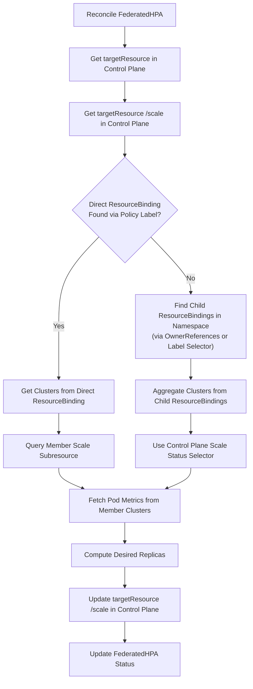

# Support Control-Plane-Only Workload Targets in FederatedHPA

## Summary

Currently, `FederatedHPA` assumes that the resource referenced by `spec.scaleTargetRef` is directly propagated to member clusters via a `PropagationPolicy` or `ClusterPropagationPolicy`. Under this assumption, the target resource in the Karmada control plane carries a `propagationpolicy.karmada.io/permanent-id` label, corresponds 1:1 with a `ResourceBinding`, and serves a `/scale` subresource on each member cluster.

However, advanced deployment controllers such as **Argo Rollouts**, **OpenKruise**, or centralized Kubernetes controllers often operate exclusively in the Karmada control plane. In these architectures, the parent custom resource (e.g. `argoproj.io/v1alpha1` `Rollout`) lives only in the control plane to orchestrate progressive canary or blue-green releases across the entire federation. The controller generates underlying child workloads (such as `apps/v1` `ReplicaSet`s) in the control plane, which are then selected by a `PropagationPolicy` and divided across member clusters.

When users configure a `FederatedHPA` to scale such a parent workload, reconciliation currently fails because:
1. The parent workload lacks propagation permanent-id labels.
2. No `ResourceBinding` directly references the parent resource name and kind.
3. Member clusters do not install the parent CRD or serve its `/scale` subresource.

This proposal extends `FederatedHPA` to support workloads that exist solely in the control plane, enabling unified multi-cluster autoscaling for progressive delivery frameworks like Argo Rollouts while preserving existing direct-propagation behaviors.

## Motivation

As multi-cluster Kubernetes adoption matures, users increasingly manage progressive delivery (canaries, blue-green deployments, experiments) centrally in the Karmada control plane. Rather than running independent canaries in every member cluster (which fragments release steps, pauses, and rollbacks), users run a single canary controller (e.g., Argo Rollouts) pointed at the Karmada API server:

```
                          Karmada Control Plane
                   +----------------------------------+
                   |           Rollout/web            | <--- FederatedHPA
                   |      (serves /scale in CP)       |      (writes desiredReplicas)
                   +----------------------------------+
                                    |
                       controls child ReplicaSets
                                    v
                   +----------------------------------+
                   |      ReplicaSet/web-<hash>       | <--- PropagationPolicy (Divided)
                   |       (ResourceBinding)          |
                   +----------------------------------+
                                    |
                 +------------------+------------------+
                 |                                     |
                 v                                     v
       Member Cluster 1                      Member Cluster 2
+-----------------------------+       +-----------------------------+
|    ReplicaSet/web-<hash>    |       |    ReplicaSet/web-<hash>    |
|      (Pods with metrics)    |       |      (Pods with metrics)    |
+-----------------------------+       +-----------------------------+
```

Under this pattern:
- The `Rollout` itself serves `/scale` in the control plane.
- The propagated `ReplicaSet` pods run in the member clusters and emit resource metrics (CPU, Memory, Custom Metrics).
- Karmada's scheduler divides the `ReplicaSet` replicas across member clusters according to policy.

Currently, pointing a `FederatedHPA` at `Rollout/web` immediately fails with `FailedGetBinding: no label of policy permanent-id found` and fails to read any metrics.

### Goals

1. Enable `FederatedHPA` to scale targets that reside solely in the Karmada control plane without requiring the target CRD or controller in member clusters.
2. Dynamically discover target member clusters and pods for control-plane-only targets via child `ResourceBinding`s and control-plane scale selectors.
3. Retain complete backwards compatibility for existing directly-propagated workloads (Deployments, StatefulSets, etc.).
4. Write scaled replica counts directly to the control plane target's `/scale` subresource, allowing the parent controller to adjust child workloads naturally.

### Non-Goals

1. Supporting arbitrary unstructured hierarchies without standard Kubernetes `ownerReferences` or matching pod label selectors.
2. Modifying Karmada's scheduler or divided replica distribution algorithm (handled independently by the existing binding and scheduler controllers).

## Proposal

### User Stories

#### Story 1: Multi-Cluster Canary with Argo Rollouts and FederatedHPA

As an application platform engineer, I manage an Argo Rollout `Rollout/web` in the Karmada control plane. A `PropagationPolicy` selects the `ReplicaSet`s created by the Rollout and divides their replicas across two member clusters. I create a `FederatedHPA` targeting `Rollout/web` with a target CPU utilization of 60%.

When traffic increases across member clusters:
1. `FederatedHPA` queries pod metrics from member clusters using the pod selector exposed by `Rollout/web`'s control-plane `/scale` subresource.
2. It calculates the aggregate desired replica count.
3. It updates `/scale` on `Rollout/web` in the control plane.
4. Argo Rollouts updates its ReplicaSets, and Karmada divides the new replicas across the member clusters.
5. The rollout can proceed through its canary steps with automated scaling.

#### Story 2: Centralized Custom Workload Controller

As a developer using a proprietary control-plane workload CRD (e.g. `AppDeployment`) that generates standard `Deployment` or `ReplicaSet` children for member propagation, I want `FederatedHPA` to autoscale `AppDeployment` directly based on aggregate member pod metrics without installing my proprietary CRD on all worker clusters.

## Design Details

### 1. Reconcile Workflow Overview

The enhanced `FHPAController.reconcileAutoscaler` workflow operates as follows:



### 2. Control-Plane `/scale` Subresource Resolution

In the existing implementation, `c.Client.SubResource("scale").Get(...)` on `targetResource` is called *after* querying member clusters. 

In the updated design:
1. The controller retrieves `templateScaleObj` from `targetResource`'s `/scale` subresource upfront in the control plane.
2. In Kubernetes `autoscaling/v1` and `autoscaling/v2`, any resource that supports `/scale` returns:
   - `spec.replicas`: the desired replicas set by the user or controller.
   - `status.replicas`: current total replicas.
   - `status.selector`: the serialized pod label selector string (e.g. `app=web`).
3. This provides the authoritative pod selector regardless of whether the target exists in member clusters.

### 3. Target Cluster & Child Binding Discovery

When `c.getBindingByLabel(ctx, targetResource.GetLabels(), hpa.Spec.ScaleTargetRef)` fails to find a direct binding:
1. The controller checks if `targetResource` has propagated child workloads by querying `ResourceBinding`s within `hpa.Namespace`.
2. A `ResourceBinding` matches `targetResource` if:
   - **Condition A (OwnerReferences):** In the control plane, the object described by `binding.Spec.Resource` contains an `ownerReferences` entry whose `UID` matches `targetResource.GetUID()` (e.g., a `ReplicaSet` owned by a `Rollout` with `controller: true`).
   - **Condition B (Selector Match):** The pod template labels in `binding.Spec.Resource` match `templateScale.Status.Selector`.
3. The controller collects all ready member clusters from the matched child bindings:
   ```go
   var allClusters []string
   for _, binding := range childBindings {
       clusters, err := c.getTargetCluster(ctx, binding)
       if err == nil {
           allClusters = append(allClusters, clusters...)
       }
   }
   allClusters = util.DedupeStringSlice(allClusters)
   ```

### 4. Metrics & Pod Collection for Control-Plane Targets

For control-plane-only targets, member clusters do not serve the target's `/scale` subresource. 
Instead:
1. The controller skips member-level `ScaleClient.Scales(...).Get()` calls.
2. It uses `templateScale.Status.Selector` directly to list pods from the member cluster pod informers (`c.buildPodInformerForCluster`).
3. Member pod metrics are fetched using the existing `c.podMetrics(metricsClient, parsedSelector, cluster)` pipeline.
4. Replicas are computed by `computeReplicasForMetrics` comparing aggregate pod metrics against `templateScale.Spec.Replicas`.

### 5. Scale Execution

Once `desiredReplicas` is computed:
```go
helper.ApplyReplica(templateScaleObj, int64(desiredReplicas), util.ReplicasField)
err = c.Client.SubResource("scale").Update(ctx, targetResource, client.WithSubResourceBody(templateScaleObj))
```
The update is written to the control plane object. The parent controller reconciles the new replica count, updates its child workloads, and Karmada distributes them automatically.

### Test Plan

- **Unit Tests:**
  - `TestReconcileControlPlaneOnlyTarget`: Verify that a FederatedHPA targeting a CRD with no propagation labels discovers child `ResourceBinding`s via `ownerReferences` and successfully computes desired replicas.
  - `TestChildBindingClusterAggregation`: Verify deduplication of clusters across multiple child bindings (e.g., canary and stable ReplicaSets).
- **Integration / E2E Tests:**
  - Create a mock control-plane CRD with child `ReplicaSet`s propagated to two member clusters.
  - Apply a `FederatedHPA` referencing the CRD.
  - Verify that `AbleToScale` condition transitions to `True` and scaling triggers when simulated pod metrics exceed target thresholds.

## Alternatives Considered

1. **Propagating the parent CRD to all member clusters:**
   - *Drawback:* Defeats centralized canary management (each cluster runs an independent canary); requires installing the CRD and controller binaries in all member clusters.
2. **Pointing FederatedHPA at child `ReplicaSet`s:**
   - *Drawback:* Causes split-brain writes against the parent controller managing the ReplicaSet; breaks canary deployments where revisions change dynamically.
3. **Running member-level HPAs:**
   - *Drawback:* Member HPAs fight with Karmada's divided scheduling algorithm, causing replica oscillation.

